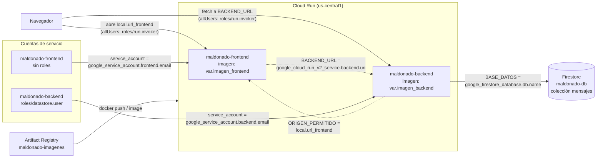

# Muro de mensajes

**Equipo:**

| Integrante | Código |
|---|---|
| Michell Mahecha | 1152407 |
| Cristian Zambrano | 1152408 |
| Scharid Maldonado | 1152418 |

**Proyecto de Google Cloud:** computanube
**URL del muro:** https://maldonado-frontend-339396341543.us-central1.run.app

## Diagrama

## Fase 0. Preparación

## Fase 1. Las imágenes

## Fase 2. Los cimientos

## Fase 3. El backend

## Fase 4. El frontend, conectado

## Fase 5. El estado vive afuera

## Fase 6. Reto
-funcionalidad nueva: dejar corazones en mensajes

-romper ciclo CORS

-gastar menos lecturas

   ---Antes

   ---Despues

-Reproduccion desde cero

### Decisiones
1. La funcionalidad nueva: reacciones. Cada mensaje tiene un botón de "me gusta" con su contador. En Firestore, cada documento nuevo se guarda con un campo likes: 0; los mensajes anteriores no lo tienen, y el backend los lee como 0 (campos.get("likes", 0)), asi que no hizo falta migrar datos. En la API, GET /mensajes ahora devuelve también el id y los likes, y hay una ruta nueva POST /mensajes/<id>/like que suma con firestore.Increment(1): la suma la hace Firestore en el servidor, sin leer antes, y si dos personas pulsan a la vez se cuentan los dos votos. Si el id no existe responde 404. En la pagina, cada mensaje muestra el boton de corazon. Como la ruta usa POST, no hubo que cambiar las cabeceras de CORS. Se publicó como v2 cambiando solo las etiquetas en terraform.tfvars. Limitación: como no hay usuarios, una misma persona puede dar varios "me gusta" a un mensaje; para un muro de clase lo aceptamos.

2. Cómo rompimos el ciclo de CORS. El frontend recibe la URL del backend por referencia, así que el backend se crea primero y no puede referenciar google_cloud_run_v2_service.frontend.uri sin formar un ciclo. Lo resolvimos con el formato fijo de las URLs de Cloud Run, https://NOMBRE-NUMERODEPROYECTO.REGION.run.app: con data "google_project" "actual" obtenemos el número del proyecto y armamos en un local la URL del frontend a partir de var.prefijo y var.region. Ese local se le pasa al backend en ORIGEN_PERMITIDO y también es la salida url_frontend. Funciona porque todos esos datos existen antes de crear cualquier servicio, así que el grafo sigue siendo acíclico. Lo que la haría fallar: abrir el muro desde la otra URL del servicio (la de -uc.a.run.app), que es justamente la evidencia 6c; cambiar el nombre del servicio sin actualizar el local; o que Google cambie el formato de las URLs.

3. Cómo bajamos las lecturas. Antes, la página pedía el muro cada 5 segundos aunque nadie la mirara: 12 peticiones por minuto × 20 mensajes × 60 = 14.400 lecturas por hora por pestaña. Cambiamos el refresco a 10 segundos y lo detenemos cuando la pestaña está oculta (evento visibilitychange); al volver, la página se pone al día de inmediato. Publicar y dar "me gusta" siguen recargando al instante. Después: 6 × 20 × 60 = 7.200 lecturas por hora con la pestaña visible (la mitad) y 0 con la pestaña oculta. Antes, una pestaña olvidada agotaba las 50.000 lecturas diarias en unas tres horas y media; ahora no gasta nada. Lo que pierde el usuario: un mensaje de otra persona puede tardar hasta 10 segundos en aparecerle.

4. Cómo resolvimos la reproducción. Terraform no construye las imágenes; si se destruye todo, el registro desaparece con ellas y un apply completo falla porque Cloud Run pide imágenes que no existen. Por eso levantamos en tres tiempos: (1) terraform apply -target=google_artifact_registry_repository.imagenes, que crea el registro y, por su depends_on, las APIs; (2) docker build y docker push de las versiones que dice terraform.tfvars; (3) terraform apply completo, que crea la base, las cuentas, el permiso y los servicios, en el orden que dan las referencias: backend antes que frontend. Problema encontrado: al terminar, la página mostraba SyntaxError: Unexpected token '<'. Con curl -i vimos que el backend respondía 500 (Flask devuelve los errores como HTML), porque la cuenta de servicio era nueva y su rol todavía no hacía efecto. A los pocos minutos se resolvió solo.

### Preguntas

1. ¿Por qué con curl la API funciona aunque falten las cabeceras de CORS, y desde la página no? Porque CORS no lo aplica el servidor sino el navegador. El backend responde igual a cualquiera; es el navegador el que, al ver que una página de un origen intenta leer una respuesta de otro origen, revisa la cabecera Access-Control-Allow-Origin y, si no autoriza a ese origen, no le entrega la respuesta al JavaScript. curl no es un navegador, no ejecuta páginas de nadie ni tiene un origen que proteger, así que simplemente muestra lo que responde el servidor. Por eso, cuando una página no puede hablar con una API que con curl sí funciona, el error hay que buscarlo en la consola del navegador.

2. Si le quitas el rol a la cuenta de servicio del backend, ¿qué deja de funcionar, y dónde encontrarías el error? El backend sigue arrancando y respondiendo ok en /, y el frontend sigue entregando la página, pero toda operación con Firestore falla: listar, publicar y dar "me gusta". Firestore rechaza las llamadas por falta de permiso, la biblioteca lanza una excepción y Flask responde 500 con una página de error en HTML; en el muro eso se ve como SyntaxError: Unexpected token '<', que fue justo lo que vimos en la reproducción mientras el rol se propagaba. El error exacto, con el permiso que faltó, aparece en los registros del servicio backend en Cloud Run (consola o gcloud run services logs read maldonado-backend --region us-central1), y se confirma con curl -i, que muestra el código 500.

3. ¿Cuánto cuesta tu muro un mes sin visitas, y cuánto si cien personas lo dejan abierto todo el día, antes y después de tu cambio del reto? Sin visitas cuesta prácticamente cero: Cloud Run apaga las instancias cuando nadie llama y no cobra por estar quieto, Firestore no tiene servidor encendido y los pocos datos caben en el GiB gratuito, y las imágenes del registro ocupan muy poco. Con cien pestañas abiertas y visibles todo el día, antes del cambio serían 100 × 14.400 × 24 = 34.560.000 lecturas diarias; quitando las 50.000 gratuitas y con el precio de us-central1 (0,03 USD por cada 100.000 lecturas), unos 10,35 USD al día, cerca de 310 USD al mes solo en Firestore. Después del cambio, con las pestañas visibles, son 17.280.000 lecturas diarias: unos 5,17 USD al día, cerca de 155 USD al mes. Si las pestañas quedan ocultas, como pasa con una pestaña olvidada, el costo de lecturas baja a cero. A esto se suma Cloud Run, que con tráfico constante mantendría una instancia activa y cobraría por CPU, memoria y peticiones (estas últimas también se reducen a la mitad con el cambio).
