# Muro de mensajes

**Equipo:**

| Integrante | Código |
|---|---|
| Michell Mahecha | 1152407 |
| Cristian Zambrano | 1152408 |
| Scharid Maldonado | 1152418 |

**Proyecto de Google Cloud:** computanube
**URL del muro:** https://maldonado-frontend-339396341543.us-central1.run.app

## Diagrama

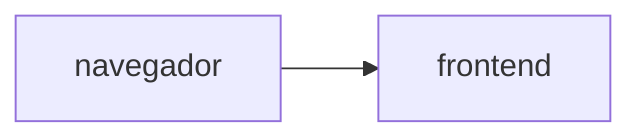

## Fase 0. Preparación

## Fase 1. Las imágenes
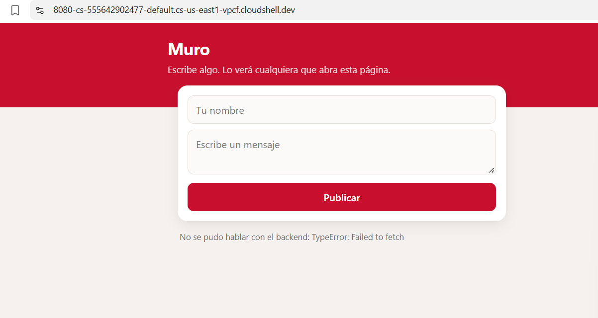
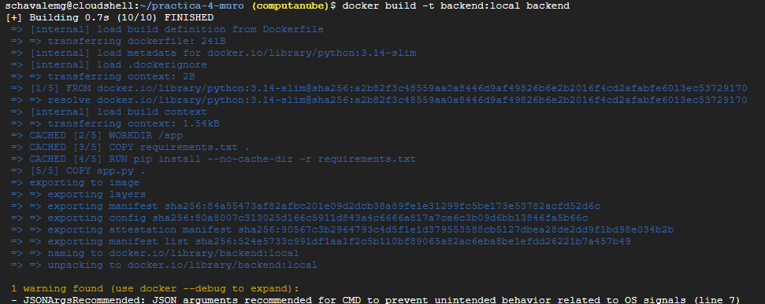

## Fase 2. Los cimientos
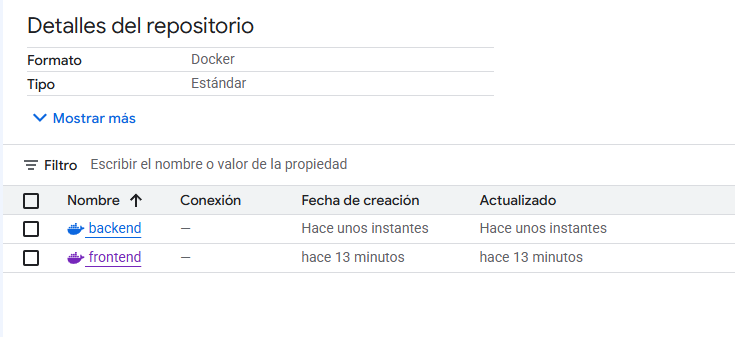
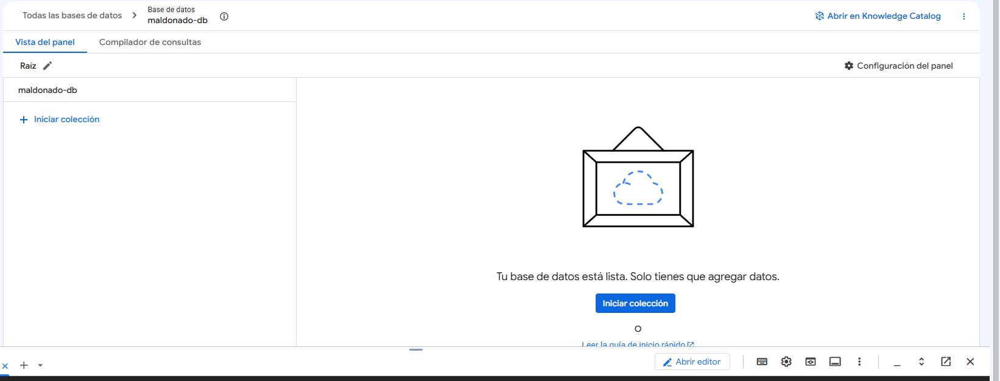

## Fase 3. El backend
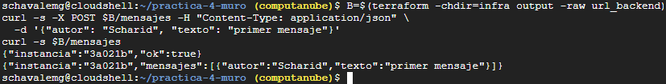
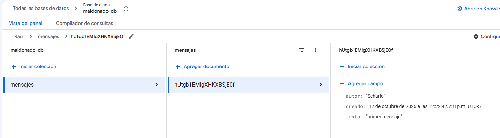

## Fase 4. El frontend, conectado
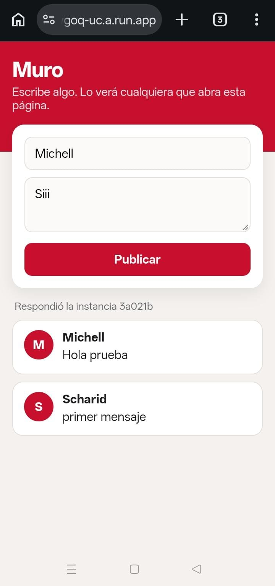

## Fase 5. El estado vive afuera
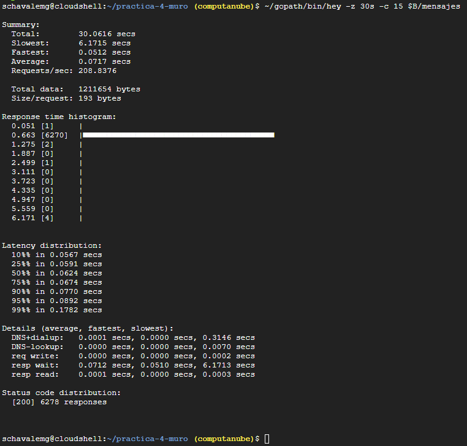
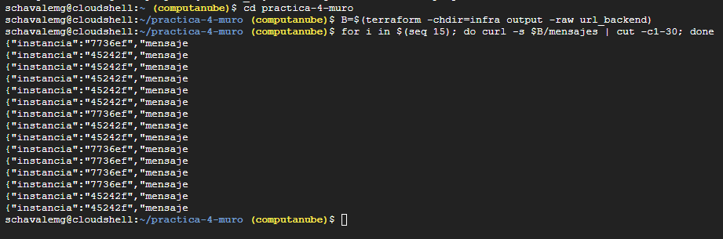
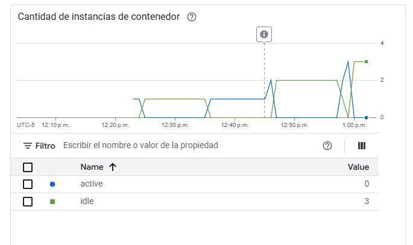

## Fase 6. Reto
-funcionalidad nueva: dejar corazones en mensajes
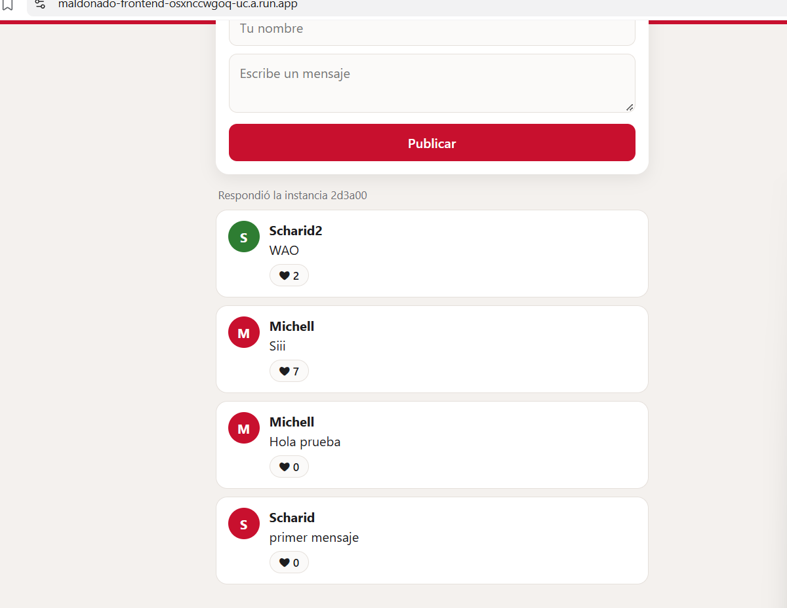
-romper ciclo CORS
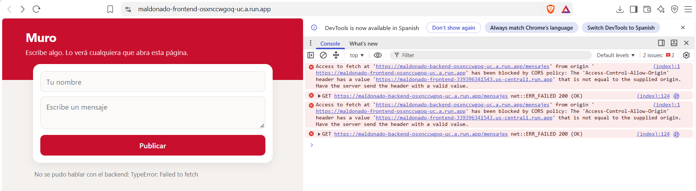
-gastar menos lecturas

   ---Antes
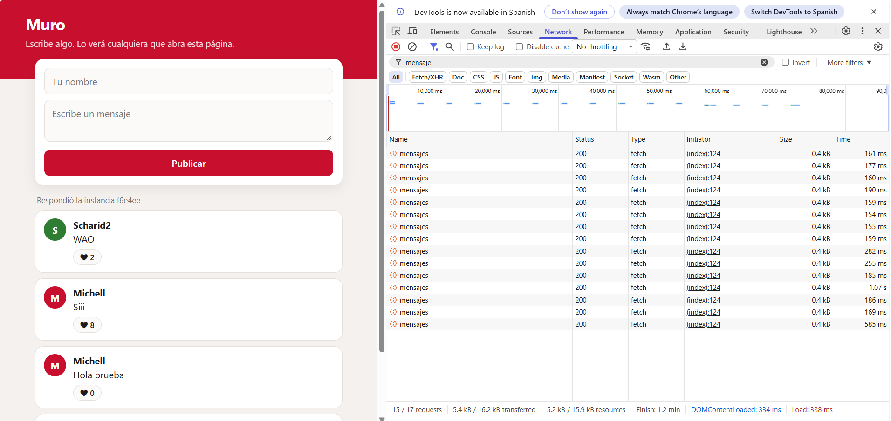

   ---Despues
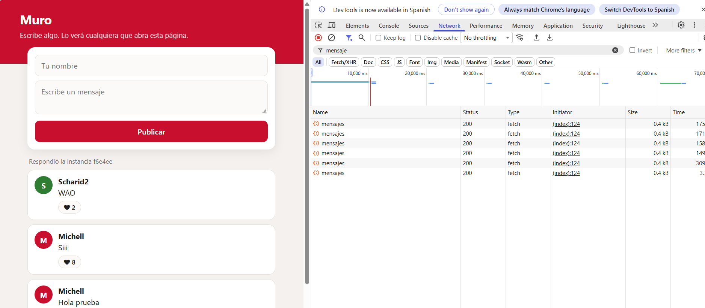

-Reproduccion desde cero
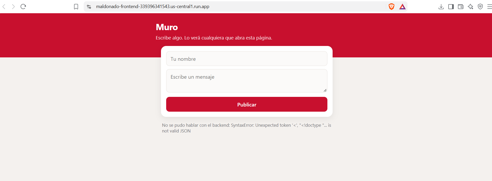

### Decisiones

### Preguntas
